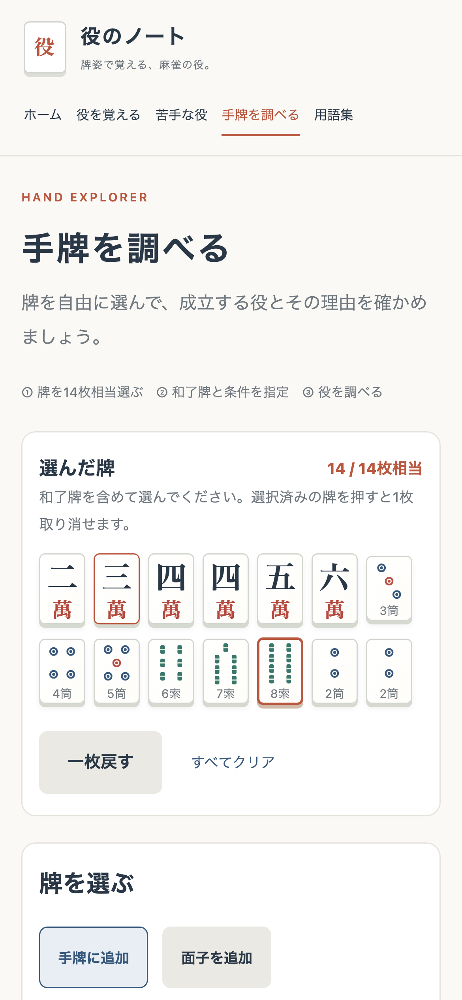
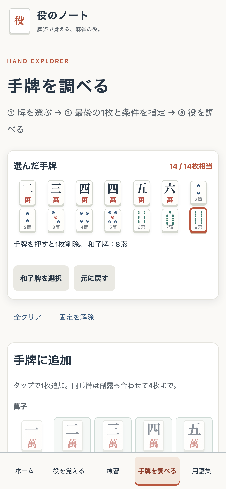

# モバイルUX改善 調査・設計記録

## 調査時点の事実

- analyzer.js の refresh は draw を通じて main 全体を置換。data-focus のある要素にだけフォーカスを復元する。
- 手牌は追加順。和了牌は種類キーで保存し、同種すべてに winning を付ける。
- 一枚戻すは手牌の末尾削除。副露削除や全クリアのUndoはない。
- パレットは4分類、物理4枚制限、14枚相当制限、候補の検証、暗槓の門前扱いが既にある。
- makeRequest は14枚相当・手牌内の和了牌・未確定候補なしを必須とする。
- Quiz はlabelによる複数選択、採点後の正解・選び忘れ・選びすぎと共通解説を実装済み。
- stats.js は保存失敗時にメモリで継続し、破損データ・履歴100件上限を既存テストで検証する。
- renderHand は表示のみソートし、和了牌を1枚だけ強調する。判定APIは面子構造と理由を返す。
- nav は折り返すCSS。モバイル用パレットは5列だが手牌が増えるとパレット自体が下に移動する。
- 既存テストは純粋操作・構文・保存・body制限。DOM操作やスクロールのE2Eはない。

## 調査からの仮説（実機での確認とは区別）

全再生成と手牌の高さ変化がフォーカス・スクロール安定性を損ねうる。長いページでナビゲーションに戻る負担がある。iOS/Android実機の挙動は未確認。

## 設計

- Vanilla JSのまま、パレット・条件select・主要操作ボタンのDOMを保持する。手牌、候補、副露、結果の領域を局所更新する。
- UIモードと入力DTOを分離。純粋操作モジュールで編集前snapshotを最大50件保持し、削除・和了牌変更・副露・クリアも復元する。
- 手牌は表示だけソート。375px以上の小画面では7列×2段、320pxでは6列×3段の領域を確保し、入力でパレット位置を動かさない。
- stickyは手牌と必要な操作のみ。解除ボタンと低い画面での自動解除を設ける。
- モバイルは主要5機能を常時見つけられる下部ナビ。苦手な役はホーム・練習結果からアクセス。
- 役の図解は監修可能な固定教材例として明示し、入力の面子をUIで推測しない。判定結果は既存APIのgroups/reasonを使用。
- Playwrightは開発依存のみ。実APIに対する回帰、タッチ、DOM保持、スクロール、viewport、保存不能、キーボードを検証する。
- 問題bank・役判定・API・学習履歴schemaは変更しない。


## 実装結果（2026-11-06）

### Milestone 1・2：入力と更新

手牌を萬・筒・索・字の順に表示し、内部配列のindexは維持する。通常のタップは削除、「和了牌を選択」中だけ指定となり、その後通常に戻る。同種牌の強調は1枚のみ。選択済み手牌・和了牌指定・Undoはsticky領域にまとめた。固定は解除でき、高さ600px以下では自動的に通常表示になる。

牌パレットの34ボタン、条件select、操作ボタンは初回だけ作り、以後は属性・表示テキストを更新する。手牌・副露・候補・結果は変更signatureを比較して各領域のみ更新する。手牌の高さを確保し、追加時にパレットを移動しない。副露はdetailsで必要時だけ開き、候補と確定操作は入力中のパレット上部に置く。

追加・削除・和了牌変更・副露操作・条件変更・全クリアを最大50件の入力snapshotから戻せる。API結果は履歴に含めず、編集後は無効にする。14枚相当、物理4枚、候補の正しさ、暗槓の門前扱いは従来処理を使う。役判定への通信は判定ボタンを押すときだけ。非同期判定中に画面を往復しても新しい画面に結果と操作可否を反映する。

### Milestone 3・4：練習と図解

スマホの牌姿は7列、選択肢は1列の大きなlabelにする。正解・選び忘れ・誤選択はテキストと記号でも区別し、サーバーの採点結果・問題解説・各役の成立条件を併記する。個々の手牌の不成立理由をUIで独自計算しない。既存解説が各誤選択の不足条件を個別には列挙していない場合は、成立条件との照合で学ぶ表示となる。

練習中の用語リンクはnative dialogで定義と例を開く。閉じるボタン・Escapeで問題に戻り、回答選択とフォーカスを維持する。練習中以外の用語リンクは従来通り用語集へ移動する。

断么九・平和・一盃口・三色同順・一気通貫・対々和・七対子の7役に、既存catalog例を明示的に分けた図解を追加した。枠・組名・説明を対応させ、平和は23索→4索の両面を示す。対々和は2萬をポンした例と明記する。ユーザー入力の分解を推測する処理は追加していない。

### Milestone 5・6：導線とアクセシビリティ

モバイルは5項目を下部に常設し、タブを開く追加操作が必要なハンバーガーは採用しなかった。現在位置は背景・下線・aria-currentで示し、safe-area下余白を確保。PCでは従来のヘッダー配置、タブレットではブランドとナビを2段にする。

牌入力と削除のタッチ領域44px以上をE2Eで確認した。SVGのラベル、ボタンの操作説明、和了牌選択モードのstatus、条件ラベル、フォーカス表示を維持し、本文へのスキップリンクが画面遷移しないよう修正。判定結果・エラーへフォーカスを移し、エラーには和了条件へ戻る操作を付けた。スクロールはreduced-motionで即時に切り替える。

## 検証

| 検証 | 結果 |
| --- | --- |
| Zig 0.17.0 / Akamata固定依存 | バージョン・依存を維持 |
| `zig build test --summary all` | Zig 29件・JS 12件成功 |
| `zig build test -Doptimize=ReleaseSafe --summary all` | Zig 29件・JS 12件成功 |
| `zig build -Doptimize=ReleaseSafe` | Nativeビルド成功 |
| `zig build -Dbackend=workers -Doptimize=ReleaseSafe` | Workersビルド成功 |
| `npm run test:e2e` | 9シナリオ×4環境 = 36件成功 |
| `node tests/http-smoke.mjs http://localhost:8787` | 3難易度・採点・秘匿DTO・検証・body上限・OpenAPI/client・役判定・49用語成功 |
| `wrangler deploy --dry-run --outdir /tmp/yaku-workers-dry-run`（deployディレクトリ） | バンドル成功、公開せず終了 |

E2E環境はmacOS上のPlaywright 1.65.0。iPhone 13相当のChromiumとWebKit、Pixel 7相当のChromium、デスクトップChromiumで確認した。各環境で320/375/390/430/768/1280pxの主要6画面に横はみ出しがないこと、844×390への回転時に固定解除されることを検査した。

連続タッチ・Enterでの入力、DOM保持、スクロール保持、5枚目・15枚目の禁止、削除、Undo、全クリア復元、和了牌指定と最後の同種牌削除、副露・暗槓、判定の非同期画面往復、エラーからの修正、Quiz複数選択・正誤表示、保存と保存拒否時の継続、戻る・進む、更新後の学習履歴、用語dialog、Spaceでのチェック、スキップリンク、図解を検証した。既存Zigテストは全35問の期待役と判定エンジンの一致を維持する。

Workersのローカル確認は既存READMEと同じく、Wrangler 4.120.0同梱workerdに合わせて `wrangler dev --local --compatibility-date 2026-08-08 --port 8787` を使用。公開用設定の2026-10-14は変更していない。CLIの意味は[Cloudflare公式Wranglerドキュメント](https://developers.cloudflare.com/workers/wrangler/commands/)も確認した。

## 変更ファイル

- `web/analyzer.js`：DOM局所更新、入力レイアウト、Undo・和了牌・副露・非同期処理。
- `web/hand-input.js`：表示用ソート、履歴付き編集、復元・和了牌・副露削除・追加可否の純粋操作。
- `web/app.js`：固定教材の図解、練習の用語dialog・フィードバック・フォーカス、練習開始画面、スキップリンク。
- `web/styles.css`：モバイル牌姿・選択肢・入力・下部ナビ・dialog・図解・reduced-motion。
- `web/index.html`：主要ナビに練習を追加。
- `tests/hand-input.test.mjs`：履歴、復元、ソート、変更拒否、和了牌、副露の追加テスト。
- `tests/e2e/mobile.spec.mjs`、`playwright.config.mjs`：実APIを使うUI回帰。
- `package.json`、`package-lock.json`：Playwrightを開発依存に限定。実行時依存の追加なし。
- `.gitignore`：E2Eの実行結果・レポートを除外。
- `README.md`：検証手順へのリンク。
- 本書と `docs/screenshots/` の3画像。

`src/analysis/`・`src/quiz/`・`src/mahjong/`・API contract・`tiles.js`・`stats.js`・学習履歴schema・Workers設定は変更していない。

## 画面比較

公開サイトの変更前と、ローカルの変更後を同じ390×844 CSS px・14枚の入力例・画面先頭で撮影した。

| 変更前 | 変更後 |
| --- | --- |
|  |  |

[練習の解説画面](screenshots/quiz-after-390.png)も保存した。変更後の画像はChromiumのE2E実行で更新される。

## 再実行とデプロイ

```sh
npm ci
npx playwright install chromium webkit
npm test
npm run test:e2e
zig build test
zig build test -Doptimize=ReleaseSafe
zig build -Doptimize=ReleaseSafe
zig build -Dbackend=workers -Doptimize=ReleaseSafe
```

8080番ポートはE2EのNativeサーバーが使用するので空けておく。Firefoxは `npx playwright install firefox` 後 `npm run test:e2e:firefox` で別途実行できる。Playwrightは保守対象をUIの9シナリオと設定1ファイルに限定し、外部テストSaaSやフロントエンドフレームワークは不要。

本番デプロイは行っていない。将来デプロイするときはREADME通りAkamata v0.2系CLIで以下を実行する（このコマンドは公開を伴う）。

```sh
akamata deploy --workers --optimize=ReleaseSafe --preflight
```

## 未確認事項・残課題・今後の候補

- iOS SafariとAndroid Chromeの実機は未確認。モバイルエミュレーションと実機での検証は区別する。
- Firefox 159のPlaywrightバイナリは `Could not find profile folder` で起動失敗。制限外実行・/tmpへの一時プロファイル変更でも再現し、アプリ検証まで到達していない。既定E2Eは動作した4環境、Firefoxは別コマンドとした。
- VoiceOver/TalkBackの読み上げ、実機ソフトキーボード、OS文字拡大・ハイコントラスト・ブラウザズームの全組み合わせは未確認。次回の実機確認項目とする。
- 手牌・Undo履歴・進行中Quizは従来通りページ内メモリ。画面往復では保持し、ページ更新でリセット。回答済みの学習履歴だけlocalStorageへ保存する。
- 全誤選択について不足条件を特定する機械的な解説生成は行わず、既存問題解説と成立条件を表示する。個別理由のさらなる充実は問題データの独立レビューと合わせて行う。
- 固定教材7役の図解は今後もcatalog例と合わせてレビューする。残りの役へは誤った分解を推測せず、明示的に確認した図だけ拡張する。
